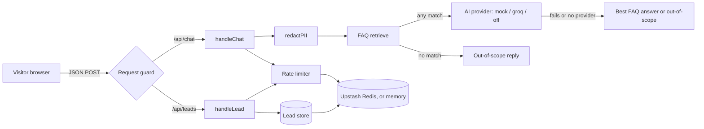

# Northwind Dental

A demo project (not a real clinic): a five-page website for a fictional boutique dental clinic, with an AI chat assistant that answers only from the clinic's FAQ and a small contact-request flow. Built with Next.js, React, TypeScript and Tailwind CSS.

## Live demo

Added after deploy.

## Features

- **Pages:** Home, Services, FAQ (searchable), Contact and `/leads` (a visitor's own contact requests).
- **Chat assistant:** a lazy-loaded chat widget. Answers come from 21 FAQ entries in five topic groups (opening hours and booking, services, costs and insurance, before your visit, aftercare). Each reply is labelled as an AI answer, a FAQ answer or "out of scope".
- **Contact requests:** a form with client-side and server-side validation. A request is kept for 24 hours and is listed on `/leads` for the same browser session, with a category (booking, pricing or other) and a short summary of the chat that led to it.
- **Responsive layout:** a viewport sweep in the e2e suite checks for horizontal overflow on five routes at ten sizes, from 320 px phones to 1920 px desktops. The menu and chat panel close with Escape and return focus to their button.
- **Design:** a "Warm Arch" design (cream canvas, sky-blue brand, peach accent). Colours are declared once as tokens in the `@theme` block of `app/globals.css`.

## Architecture



Server code lives in `lib/` (chat, FAQ, AI providers, guards, key-value client, leads) and is called from two route handlers in `app/api/`. The UI is in `app/` and `components/`.

## How the chatbot stays within the FAQ

1. **Redact.** The visitor's message and every history item sent by the browser go through `redactPII` first.
2. **Retrieve.** A keyword matcher (`lib/faq/retrieve.ts`) scores each FAQ entry from 0 to 1 against the redacted question.
3. **Out of scope.** If no entry matches at all, a fixed reply is returned and no AI call is made. The reply lists the topics the assistant can help with.
4. **Ask the model.** If at least one entry matches, the best three entries are sent to the AI provider together with a fixed system prompt. The prompt tells the model to answer only from those entries, to refuse questions that are not about the clinic, to give no personal medical advice, and to treat the visitor's text as data. The model is limited to 300 tokens and an 8-second timeout.
5. **Fallback when AI fails.** If there is no provider (`AI_MODE` unset or `off`), or the provider errors, times out, is cut short or returns nothing, the server returns the best FAQ answer word for word, but only when the match is confident (score of at least 0.35). A weaker match gets the out-of-scope reply instead of a probably wrong answer.

Because retrieval is keyword-based, some off-topic questions that share a word with the FAQ still reach the model. The system prompt is the defence for those cases (see Limitations).

## Security

- **`redactPII`** replaces email addresses and phone-like digit runs with `[email]` and `[phone]` before text is retrieved against, sent to the AI provider or stored in a lead summary. It reduces risk; it is not complete (see Limitations).
- **Rate limiting.** Chat: 20 messages per 10 minutes per session. Contact requests: 3 per session per 24 hours. Counters are atomic in Upstash Redis when it is configured; if the store is unreachable the app falls back to per-instance memory.
- **Request guard (CSRF).** Both POST routes accept only `Content-Type: application/json`, reject a `Sec-Fetch-Site` other than `same-origin` or `none`, and reject an `Origin` that does not match the request host. A rejected request gets no cookie and reaches no limiter, provider or store.
- **Session cookie.** `nd_session` holds a random id plus an HMAC-SHA256 signature made with `SESSION_SECRET`. It is `HttpOnly`, `SameSite=Lax`, valid for 24 hours and `Secure` in production. In production the session code throws an error if `SESSION_SECRET` is missing or shorter than 16 characters, so it never signs with a weak key. It is an anonymous session, not a login.
- **Input limits.** Request bodies are capped at 32 KB, chat messages at 500 characters, and stored lead data at 4096 bytes.
- **Rendering.** Stored lead text (name, note, summary) is rendered as plain text only.
- **Logging.** The server logs only fixed kinds of failure (for example a provider or key-value failure kind). It never logs message text, contact details, keys or URLs.

## Testing

| Suite | Count | Command |
| --- | --- | --- |
| Unit and integration (Vitest) | 721 tests in 26 files | `npm test` |
| End to end (Playwright, Chromium) | 93 tests in 6 files | `npm run build` then `npm run test:e2e` |

Both counts come from real runs of the commit that carries this README (the e2e count from `playwright test --list`). The GitHub Actions workflow `.github/workflows/ci.yml` runs lint, `tsc --noEmit`, the unit tests, a production build and the e2e suite on every push to `main` and on pull requests. It uses no repository secrets and no real AI or database: AI runs in mock mode and the key-value store is disabled.

The Playwright suite in `tests/e2e/` drives the real production build in Chromium (desktop and a 375x667 phone project). It covers the chat answers and badges (AI answer, FAQ fallback, out of scope), the chat widget behaviour (conversation kept on close and reopen, Escape and focus, lazy panel chunk, chunk failure and "Try again"), the lead form and the `/leads` page (success, the 3-per-session limit, per-session isolation, plain-text rendering, client validation, chat history in the lead request), the request guard and lead API status codes, and a viewport sweep (no horizontal overflow on five routes at ten sizes). `tests/e2e/UI-CONTRACT.md` lists the test ids, roles and copy the tests rely on.

```bash
npx playwright install chromium   # once
npm run build
npm run test:e2e
npx playwright show-report        # HTML report in playwright-report/
```

The suite starts `next start` on port 3400 (it fails if the port is taken or if `npm run build` was not run). The server always runs with mock AI, a fake session secret and no key-value store (the four KV variables are forced to a blank value), whatever your shell or local env file contains, so it never reaches Groq or Upstash. Leads and counters live in server memory, and each test uses its own browser context, so tests do not share a session.

### Live tests (`@live`, manual only)

`tests/e2e/live.spec.ts` sends real questions to Groq (one in scope, two off-topic questions, one prompt-injection attempt). It is never part of `npm run test:e2e` and is never run in CI. It costs Groq quota. To run it yourself, set `GROQ_API_KEY` (required) and `GROQ_MODEL` (optional, default `openai/gpt-oss-20b`) in your own PowerShell session, for example by loading your local env file in that shell, then run:

```powershell
npm run build; npm run test:e2e:live
```

It uses port 3401, never uses the key-value store, and stops with a clear error if `GROQ_API_KEY` is not set. Model answers vary, so the assertions are tolerant (badge, no error, refusal topics, no price or time, no system prompt text).

## Run locally

Requirements: Node.js 26 (see `.nvmrc`) and npm.

```bash
npm ci
cp .env.example .env.local   # then edit the copy; it is git-ignored
npm run dev                  # http://localhost:3000
```

Other scripts: `npm run lint`, `npm test`, `npm run build`, `npm start`.

### Environment variables

All variables are server-only. Never add a `NEXT_PUBLIC_` prefix. `.env.example` lists them with placeholder values.

| Name | Required | Description |
| --- | --- | --- |
| `AI_MODE` | No | `mock`, `groq` or `off`. Unset or any other value behaves as `off`. See "AI modes". |
| `GROQ_API_KEY` | Only for `AI_MODE=groq` | API key for Groq. |
| `GROQ_MODEL` | No | Groq model name. Defaults to `openai/gpt-oss-20b`. |
| `SESSION_SECRET` | Yes in production | Key for signing the session cookie, at least 16 characters. Outside production a fixed, insecure development value is used when it is missing. |
| `UPSTASH_REDIS_REST_URL` | Recommended in production | Upstash Redis REST URL (must be `https://`). |
| `UPSTASH_REDIS_REST_TOKEN` | Recommended in production | Upstash Redis REST token. |
| `KV_REST_API_URL` | Alternative | Same as the `UPSTASH_REDIS_REST_URL` above; read only if the `UPSTASH_*` pair is not set. |
| `KV_REST_API_TOKEN` | Alternative | Same as the `UPSTASH_REDIS_REST_TOKEN` above; read only if the `UPSTASH_*` pair is not set. |
| `VERCEL_PROJECT_PRODUCTION_URL` | No | Set by Vercel, not by you. The production host name, used as `metadataBase` so that og:image URLs are absolute. Falls back to `http://localhost:3000`. |

Without the key-value variables, rate-limit counters and leads are kept in memory of the single server process.

### AI modes

| `AI_MODE` | What happens |
| --- | --- |
| `mock` | An offline provider answers with the best matching FAQ entry. No network calls. Used by the tests and for demos. |
| `groq` | Questions that match the FAQ are sent to the Groq chat completions API with the model from `GROQ_MODEL`. No streaming. |
| `off` (or unset) | No AI call. The server returns the best FAQ answer for a confident match, otherwise the out-of-scope reply. This is the safe default: a typo or a missing variable never sends data to a third party. |

## Deploying to Vercel

1. Import the repository in Vercel (Node.js 26 is supported; `.nvmrc` and `engines` request it).
2. Set these environment variables for Production: `SESSION_SECRET`, `AI_MODE`, and, when using Groq, `GROQ_API_KEY` (and optionally `GROQ_MODEL`).
3. Add an Upstash Redis database and set `UPSTASH_REDIS_REST_URL` and `UPSTASH_REDIS_REST_TOKEN` (or let the Vercel Marketplace integration set `KV_REST_API_URL` and `KV_REST_API_TOKEN`). This is required, not optional: without it each serverless instance keeps its own memory and `/leads` is unreliable.
4. Keep the project setting "Enable access to System Environment Variables" (Settings, Environment Variables) turned on so that Vercel provides `VERCEL_PROJECT_PRODUCTION_URL` ([Vercel docs](https://vercel.com/docs/environment-variables/system-environment-variables), checked 2026-11-13).

Do not set a `Referrer-Policy` of `no-referrer`: the request guard rejects `Origin: null`, and a same-origin POST may carry it under that policy.

## Limitations

- **Images are AI-generated.** The clinic photos are rendered images made for this fictional clinic. They show no real people, doctors or logos. Service icons are hand-written SVG.
- **Lead data is short-lived and stored at a third party.** A contact request (email, optional name and note, a category and a short summary derived from the redacted chat) is stored for 24 hours and then deleted. When the key-value store is configured, it is stored at Upstash.
- **Upstash Free is not encrypted at rest.** Encryption at rest is an add-on that the Free plan does not include. The connection itself uses TLS. Use only fake contact details in this demo.
- **The memory fallback is per instance.** Without the key-value store, leads and counters live in one server process. Serverless instances (for example on Vercel) do not share it, so a deployment must configure the store.
- **`redactPII` reduces risk but is not complete.** It does not catch names or addresses typed in the chat, or disguised forms such as "john at gmail dot com". Dates, times and amounts with 9 or more digits are over-redacted (for example "2026-11-09 10:30" becomes "[phone]:30"), and 9+ digit runs inside longer IDs are redacted. An email local part longer than 64 characters keeps its first characters. Digits from other scripts and an ideographic full stop in an email are not caught. In scripts written without spaces (for example Chinese) an email can swallow up to 64 letters before the "@". Unicode normalisation and invisible-character stripping change the text (for example "1½" becomes "11⁄2").
- **Chat content is sent to Groq.** In `groq` mode, the redacted question, up to four redacted history items and the matching FAQ entries are sent to Groq. When a contact request is saved, the redacted chat history is also sent to Groq to pick a category and summary. Form fields (name, email, note) are not sent. Because redaction is incomplete, do not type personal data into the chat.
- **FAQ retrieval is keyword-based.** Some off-topic questions that share a word with the FAQ (for example "what is the price of bitcoin") reach the model, which is why the system prompt must refuse off-topic questions. In fallback mode (no AI), long multi-topic questions can score below the confidence threshold and get the out-of-scope reply.
- **The rate limiter is best-effort.** It counts per session cookie, so a client that drops cookies gets a fresh counter. The in-memory limiter is per instance and fails open when its key cap is reached. It is not abuse-proof.
- **`/leads` is tied to the browser session, not to a person.** There is no login. A visitor sees only the requests saved under their own session cookie, and clearing cookies hides them.
- **Not a real clinic.** The text on the site is demo copy. It makes no medical claims and no real appointment is booked.

## Images and design assets

- Clinic visuals are AI-generated rendered images, optimised to WebP with size budgets (Hero up to 110 KB, content images up to about 60 to 95 KB). Hand-written SVG icons follow the design tokens.
- Five of the seven images in `public/images/` appear on the Home page (`hero-clinic.webp`, `reception.webp`, `treatment-room.webp`, `equipment-bay.webp`, `welcome.webp`). `waiting-lounge.webp` (an imaging room) is used on the Contact page. `cleaning.webp` is currently unused (spare).
- Raw image generation sources are kept in `assets-src/` (git-ignored).
