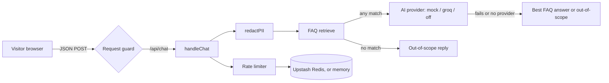

# Northwind Dental

[](https://github.com/huutin000/northwind-dental/actions/workflows/ci.yml)

A demo project (not a real clinic): a four-page website for a fictional boutique dental clinic, with an AI chat assistant that answers only from the clinic's FAQ and a demo appointment request form that sends nothing. Built with Next.js, React, TypeScript and Tailwind CSS.

Built with AI coding assistance (Claude Code). I defined the design and scope, reviewed each milestone, and verified the result with the test suite and CI.

## Live demo

[https://northwind-dental.vercel.app/](https://northwind-dental.vercel.app/)

## Features

- **Pages:** Home, Services, FAQ (searchable), and Contact.
- **Chat assistant:** a lazy-loaded chat widget. Answers come from 21 FAQ entries in five topic groups (opening hours and booking, services, costs and insurance, before your visit, aftercare). Each reply is labelled as an AI answer, a FAQ answer or "out of scope".
- **Contact page:** a demo "Request an appointment" form. It sends nothing and stores nothing; the chat is the only server feature.
- **Responsive layout:** the layout is checked at many screen sizes (see Testing). The menu and chat panel close with Escape and return focus to their button.
- **Design:** a "Warm Arch" design (cream canvas, sky-blue brand, peach accent). Colours are declared once as tokens in the `@theme` block of `app/globals.css`. The tab icon (SVG), a 512 px PNG icon and a 180 px Apple touch icon are drawn from one tooth shape, and the browser theme color is the brand blue.

## Architecture



Server code lives in `lib/` (chat, FAQ, AI providers, guards, key-value client) and is called from one route handler, `app/api/chat`. The UI is in `app/` and `components/`.

## How the chatbot stays within the FAQ

1. **Redact.** The visitor's message and every history item sent by the browser go through `redactPII` first.
2. **Retrieve.** A keyword matcher (`lib/faq/retrieve.ts`) scores each FAQ entry from 0 to 1 against the redacted question.
3. **Out of scope.** If no entry matches at all, a fixed reply is returned and no AI call is made. The reply lists the topics the assistant can help with.
4. **Ask the model.** If at least one entry matches, the best three entries are sent to the AI provider together with a fixed system prompt. The prompt tells the model to answer only from those entries, to refuse questions that are not about the clinic, to give no personal medical advice, and to treat the visitor's text as data. The model is limited to 300 tokens and an 8-second timeout.
5. **Fallback when AI fails.** If there is no provider (`AI_MODE` unset or `off`), or the provider errors, times out, is cut short or returns nothing, the server returns the best FAQ answer word for word, but only when the match is confident (score of at least 0.35). A weaker match gets the out-of-scope reply instead of a probably wrong answer.

Because retrieval is keyword-based, some off-topic questions that share a word with the FAQ still reach the model. The system prompt is the defence for those cases (see Limitations).

## Security

- **`redactPII`** replaces email addresses and phone-like digit runs with `[email]` and `[phone]` before the text is matched against the FAQ or sent to the AI provider. It reduces risk; it is not complete (see Limitations).
- **Rate limiting.** Chat: 20 messages per 10 minutes per session, and 60 messages per 10 minutes per client (an anonymised key, so one client cannot get a fresh allowance by dropping its cookie; IPv6 clients are grouped by /64). Counters are atomic in Upstash Redis when it is configured; if the store is unreachable the app falls back to per-instance memory.
- **Request guard (CSRF).** The POST route `/api/chat` accepts only `Content-Type: application/json`, rejects a `Sec-Fetch-Site` other than `same-origin` or `none`, and rejects an `Origin` that does not match the request host. A rejected request gets no cookie and reaches no limiter or provider.
- **Session cookie.** `nd_session` holds a random id plus an HMAC-SHA256 signature made with `SESSION_SECRET`. It is `HttpOnly`, `SameSite=Lax`, valid for 24 hours and `Secure` in production. In production the session code throws an error if `SESSION_SECRET` is missing or shorter than 16 characters, so it never signs with a weak key. It is an anonymous session, not a login.
- **Security headers.** Every route, including API responses and the 404 page, sends `X-Content-Type-Options: nosniff`, `X-Frame-Options: DENY`, `Referrer-Policy: strict-origin-when-cross-origin` and `Permissions-Policy: camera=(), microphone=(), geolocation=()` (set in `next.config.ts`, pinned by `tests/e2e/headers.spec.ts`). `Strict-Transport-Security` is added by Vercel, not by the app. Keep `Referrer-Policy` at `strict-origin-when-cross-origin` and do not use `no-referrer`: the request guard rejects `Origin: null`, which that policy could cause for some request types (not verified here; Chromium's default `fetch` still sent the real origin).
- **Input limits.** Request bodies are capped at 32 KB, and chat messages at 500 characters.
- **Logging.** The server logs only fixed kinds of failure (for example a provider or key-value failure kind). It never logs message text, keys or URLs.

## Testing

| Suite | Count | Command |
| --- | --- | --- |
| Unit and integration (Vitest) | 613 tests in 20 files | `npm test` |
| End to end (Playwright, Chromium) | 127 tests in 8 files (0 `@live`) | `npm run build` then `npm run test:e2e` |

Both counts come from real runs of the commit that carries this README (the e2e count from `playwright test --list`). The GitHub Actions workflow `.github/workflows/ci.yml` runs lint, `tsc --noEmit`, the unit tests, a production build and the e2e suite on every push to `main` and on pull requests. It uses no repository secrets and no real AI or database: AI runs in mock mode and the key-value store is disabled.

The Playwright suite in `tests/e2e/` drives the real production build in Chromium (desktop and a 375x667 phone project). It covers the chat answers and badges (AI answer, FAQ fallback, out of scope), the chat widget behaviour (conversation kept on close and reopen, Escape and focus, lazy panel chunk, chunk failure and "Try again"), the link from the chat to the contact form, the request guard on the chat API, the security headers on a page, an API response and the 404 page, the icon links and theme color, and a viewport sweep (no horizontal overflow on four routes at ten sizes, from 320 px to 1920 px wide). `tests/e2e/UI-CONTRACT.md` lists the test ids, roles and copy the tests rely on.

```bash
npx playwright install chromium   # once
npm run build
npm run test:e2e
npx playwright show-report        # HTML report in playwright-report/
```

The suite starts `next start` on port 3400 (it fails if the port is taken or if `npm run build` was not run). The server always runs with mock AI, a fake session secret and no key-value store (the four KV variables are forced to a blank value), so by design it does not use Groq or Upstash even if your shell or local env file contains keys. Counters live in server memory, and each test uses its own browser context, so tests do not share a session.

### Live tests (`@live`, manual only)

`tests/e2e/live.spec.ts` sends real questions to Groq (one in scope, two off-topic questions, one prompt-injection attempt). It is never part of `npm run test:e2e` and is never run in CI. It costs Groq quota. To run it yourself, set `GROQ_API_KEY` (required) and `GROQ_MODEL` (optional, default `openai/gpt-oss-20b`) in your own PowerShell session, for example by loading your local env file in that shell, then run:

```powershell
npm run build; npm run test:e2e:live
```

It uses port 3401, never uses the key-value store, and stops with a clear error if `GROQ_API_KEY` is not set. Model answers vary, so the assertions are tolerant (badge, no error, refusal topics, no price or time, no system prompt text).

## Performance

Measured on 2026-11-13 (about 03:47 to 03:50 UTC), after the security headers and icons were live, against the live site (https://northwind-dental.vercel.app/) with Lighthouse 13.5.0, run through `npx` (not installed in the project), default mobile preset, 3 runs per page; the table shows the median of the 3 runs. Conditions: headless Chrome 157 on a Windows PC in Vietnam, Lighthouse's default simulated throttling. Scores and timings change from run to run and with network conditions, so treat them as a snapshot, not a guarantee.

| Page | Performance | Accessibility | Best Practices | SEO | LCP (ms) | CLS | TBT (ms) |
| --- | --- | --- | --- | --- | --- | --- | --- |
| `/` | 99 | 100 | 100 | 100 | 2118 | 0 | 61 |
| `/services` | 99 | 100 | 100 | 100 | 2018 | 0 | 63 |
| `/faq` | 99 | 100 | 100 | 100 | 2008 | 0 | 64 |
| `/contact` | 99 | 100 | 100 | 100 | 2070 | 0 | 53 |

## Run locally

Requirements: Node.js 26 (see `.nvmrc`) and npm.

```bash
npm ci
cp .env.example .env.local   # then edit the copy; it is git-ignored
npm run dev                  # http://localhost:3000
```

Other scripts: `npm run lint`, `npm test`, `npm run build`, `npm start`.

### Environment variables

All variables are server-only. Never add a `NEXT_PUBLIC_` prefix. `.env.example` lists them with placeholder values.

| Name | Required | Description |
| --- | --- | --- |
| `AI_MODE` | No | `mock`, `groq` or `off`. Unset or any other value behaves as `off`. See "AI modes". |
| `GROQ_API_KEY` | Only for `AI_MODE=groq` | API key for Groq. |
| `GROQ_MODEL` | No | Groq model name. Defaults to `openai/gpt-oss-20b`. |
| `GROQ_DAILY_CAP` | No | Most Groq calls the whole site makes per 24 hours, chat answers only. A positive whole number; unset or invalid means 300. Over the limit the site answers from the FAQ. Used only with `AI_MODE=groq`. |
| `SESSION_SECRET` | Yes in production | Key for signing the session cookie, at least 16 characters. Outside production a fixed, insecure development value is used when it is missing. |
| `UPSTASH_REDIS_REST_URL` | Recommended in production | Upstash Redis REST URL (must be `https://`). |
| `UPSTASH_REDIS_REST_TOKEN` | Recommended in production | Upstash Redis REST token. |
| `KV_REST_API_URL` | Alternative | Same as the `UPSTASH_REDIS_REST_URL` above; read only if the `UPSTASH_*` pair is not set. |
| `KV_REST_API_TOKEN` | Alternative | Same as the `UPSTASH_REDIS_REST_TOKEN` above; read only if the `UPSTASH_*` pair is not set. |
| `VERCEL_PROJECT_PRODUCTION_URL` | No | Set by Vercel, not by you. The production host name, used as `metadataBase` so that og:image URLs are absolute. Falls back to `http://localhost:3000`. |

Without the key-value variables, rate-limit counters are kept in memory of the single server process.

### AI modes

| `AI_MODE` | What happens |
| --- | --- |
| `mock` | An offline provider answers with the best matching FAQ entry. No network calls. Used by the tests and for demos. |
| `groq` | Questions that match the FAQ are sent to the Groq chat completions API with the model from `GROQ_MODEL`. No streaming. |
| `off` (or unset) | No AI call. The server returns the best FAQ answer for a confident match, otherwise the out-of-scope reply. This is the safe default: a typo or a missing variable never sends data to a third party. |

## Deploying to Vercel

1. Import the repository in Vercel (Node.js 26 is supported; `.nvmrc` and `engines` request it).
2. Set these environment variables for Production: `SESSION_SECRET`, `AI_MODE`, and, when using Groq, `GROQ_API_KEY` (and optionally `GROQ_MODEL` and `GROQ_DAILY_CAP`).
3. Add an Upstash Redis database and set `UPSTASH_REDIS_REST_URL` and `UPSTASH_REDIS_REST_TOKEN` (or let the Vercel Marketplace integration set `KV_REST_API_URL` and `KV_REST_API_TOKEN`). This is required, not optional: without it each serverless instance keeps its own rate-limit and Groq-cap counters in memory.
4. Keep the project setting "Enable access to System Environment Variables" (Settings, Environment Variables) turned on so that Vercel provides `VERCEL_PROJECT_PRODUCTION_URL` ([Vercel docs](https://vercel.com/docs/environment-variables/system-environment-variables), checked 2026-11-13).

Do not set a `Referrer-Policy` of `no-referrer`: the request guard rejects `Origin: null`, which that policy could cause for some request types (for example form submissions; not verified here, Chromium's default `fetch` still sent the real origin).

## Limitations

- **Images are AI-generated.** The clinic photos are rendered images made for this fictional clinic. They show no real people, doctors or logos. Service icons are hand-written SVG.
- **The contact form is a demo.** The "Request an appointment" form on `/contact` sends nothing and stores nothing. The key-value store is used only for the chat rate limit and the Groq daily cap (counters, no chat text).
- **Upstash Free is not encrypted at rest.** According to the Upstash pricing page, encryption at rest is part of the paid "Prod Pack" add-on, which "can be purchased for any plan except the Free tier" ([Upstash pricing](https://upstash.com/pricing/redis), checked 2026-11-13). The connection itself uses TLS. Only counters are stored there.
- **The memory fallback is per instance.** Without the key-value store, counters live in one server process. Serverless instances (for example on Vercel) do not share it, so a deployment must configure the store.
- **`redactPII` reduces risk but is not complete.** It does not catch names or addresses typed in the chat, and it does not catch disguised emails such as "john at gmail dot com". It can also over-redact long digit runs such as dates, times and amounts (for example "2026-11-09 10:30" becomes "[phone]:30").
- **Chat content is sent to Groq.** In `groq` mode, the redacted question, up to four redacted history items and the matching FAQ entries are sent to Groq. Every request to Groq also carries a fixed system prompt. The contact form sends nothing, so its fields never reach Groq. Because redaction is incomplete, do not type personal data into the chat.
- **The Groq daily cap is best-effort.** `GROQ_DAILY_CAP` (default 300) limits real Groq calls per 24 hours for the whole site (chat answers only). The 24 hours start at the first counted call, not at midnight. The cap uses the same counter store as the rate limiter, so without the key-value store, or while it is down, each server instance counts for itself and the real total can reach the cap times the number of instances. Over the cap the site answers from the FAQ, with no error and no AI label (the server writes one fixed log line per refused chat message). It does not apply to `mock` or `off` mode.
- **FAQ retrieval is keyword-based.** Some off-topic questions that share a word with the FAQ (for example "what is the price of bitcoin") reach the model, which is why the system prompt must refuse off-topic questions. In fallback mode (no AI), long multi-topic questions can score below the confidence threshold and get the out-of-scope reply.
- **The rate limiter is best-effort.** It counts per session cookie, so a client that drops cookies gets a fresh counter. The in-memory limiter is per instance and fails open when its key cap is reached. The per-client limit is also best-effort: IPv6 clients are grouped by /64, so a client with a larger IPv6 delegation (for example /56 or /48) still gets several counters, and on a host that does not set the client address headers itself the limit can be bypassed. It is not abuse-proof.
- **No Content-Security-Policy.** A policy that blocks inline scripts needs a fresh nonce on every request, and Next.js can apply a nonce only when pages are rendered dynamically on each request. That would give up the static pages that are served from the CDN, so this demo ships the four headers above but no CSP.
- **Not a real clinic.** The text on the site is demo copy. It makes no medical claims and no real appointment is booked.

## License

MIT, see [LICENSE](LICENSE). The license applies to the source code.
